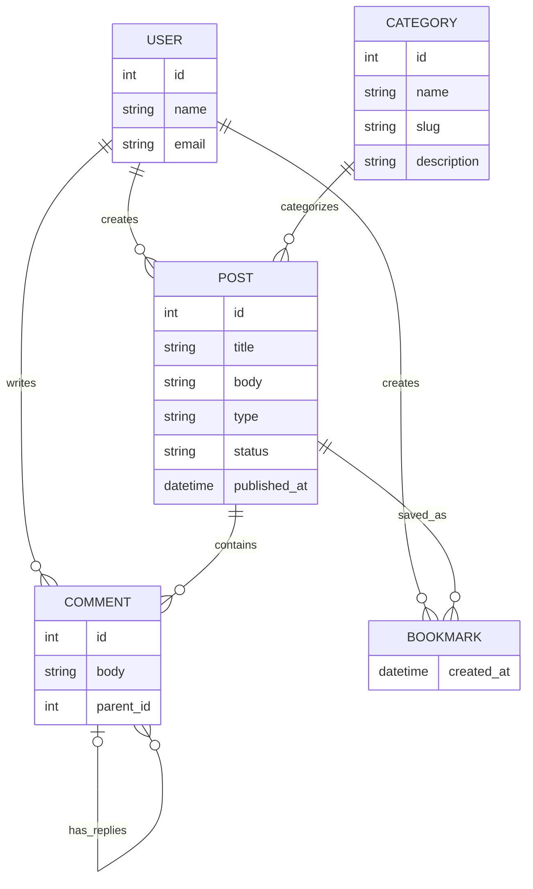
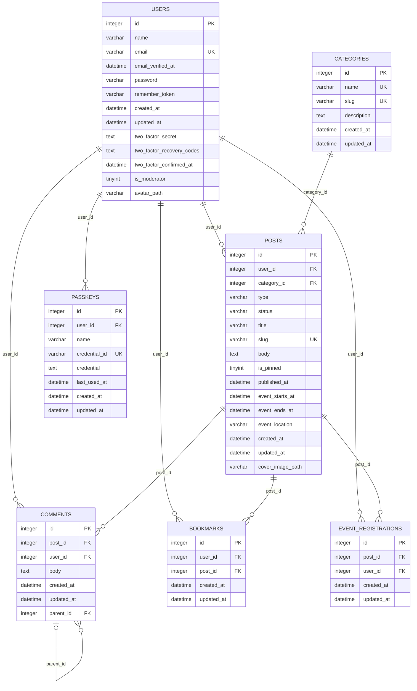

## myITS Broadcast
myITSBroadcast is a student bulletin board web website designed to centralize campus-related information for the Institut Teknologi Sepuluh Nopember (ITS) community. It allows users to publish and discover announcements and events through a public feed, search and filter content, open post details, and interact with published posts through comments and bookmarks. Authenticated users can create and manage their own posts and use a personal dashboard to review their content and saved posts.

The website is built with Laravel and follows its Model--View--Controller (MVC) structure. The current project uses a Livewire-based Laravel starter kit, Blade views, Tailwind CSS, and SQLite for local persistence. The database defines relationships between users, posts, categories, comments, and bookmarks, including multiple foreign-key constraints.

Built by three students as a midterm project of web programming class.
| Name | NRP | Contribution |
|---|---|---|
| Marvel Timothy N. | 5025251209  | Backend, database design, authentication implementation |
| Joel Angga Fransmartua Manalu | 5025251212 | Features, testing, final Report |
| Syabil Zihni | 5025251217 | Frontend, UI/UX, and project documentation. |

## Main Features
- Announcement feed
- Categories and post types
- Search and filtering
- Post detail pages
- Create posts
- Edit and delete posts
- Comments
- Bookmarks
- Personal dashboard

## Conceptual Data Model (CDM)

## Physical Data Model (PDM)

